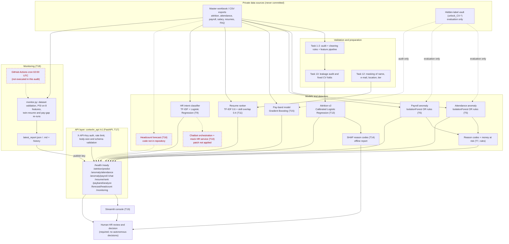

# CortexHR Architecture

Built from the code in this repository. Solid boxes exist and were exercised locally in this audit; dashed boxes exist only as configuration or are missing/not integrated. All data is fictional.

## Components
* **Data and preparation** - Task 1-2 clean rows (duplicates, negative tenure) and build the feature pipeline; Task 13 refuses leakage columns and rebuilds the Task 3 folds (fingerprint `646e474fae66cb0c`); Task 12 masks identity text before resume scoring.
* **Models** - one trained classifier for attrition, one text classifier for intents, one regressor for pay bands, two unsupervised anomaly detectors with rules, and a non-trained resume ranker. The forecast model (Task 16) and the Task 10 conversational layer are not available in the repository.
* **API** - one versioned FastAPI app; models load once at start-up and an unavailable model returns 503 for its own endpoint while others keep working (verified locally: forecast returned 503, the rest 200).
* **Monitoring** - `monitor.py` never retrains; it writes a report and exits 0/1/2/3. The API only stores and serves the latest report.

## Flows
* **Data flow**: private workbook/CSV -> cleaning -> features -> model artifact (built offline) -> artifact directory read by the API at start-up.
* **API flow**: client sends `X-API-Key` -> auth, rate limit, size and schema checks -> model call -> JSON with `model_version` and `request_id`; errors return a uniform error body (401, 422, 503).
* **Inference flow (attrition)**: records -> strict schema (unknown fields rejected) -> saved pipeline (impute/scale/encode) -> calibrated probability -> rank-based band (needs 10+ records) -> human review.
* **Monitoring flow**: monitor.py -> PSI (OK < 0.10, WATCH 0.10-0.25, ALERT > 0.25) + fairness re-runs -> `OK/WATCH/ALERT` -> artifact / optional publish to `/v1/monitoring/report` -> Streamlit Monitoring view.
